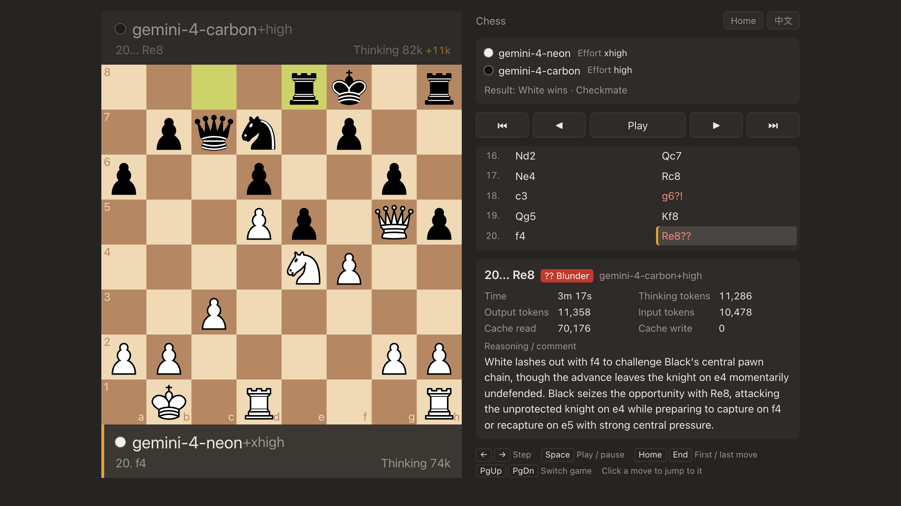

[English](README.md) | [简体中文](README.zh-CN.md)

# agi-chess

**如果连象棋都下不明白，那就不能称为 AGI 了。** 中国象棋与国际象棋规则透明、信息完全公开，常人不经专门训练也能下得有来有回；从眼前局面一步步推出后着，与从已知一步步推出未知本是一脉相承的推理能力。哪怕模型在写代码、解难题上再拿手，只要离开外部引擎、自己坐到棋盘前就频频漏算送子，它就仍是偏科的“锯齿状智能”，离真正的“通用”还差一层。

本项目让未经棋类专训的通用大模型在不借引擎、不给合法着法提示的条件下，像真人一样下国际象棋与中国象棋，实测它们的真实棋力、拆解它们为何犯错，并检验思考深度、局面表示与思考延续方式对下法的影响。仓库收录了完整的对弈与局面题程序、192 盘正式对局棋谱、9 批局面题数据、等级分标定脚本、研究报告及配套棋谱阅读器。

> **免安装在线棋谱阅读器（GitHub Pages）：[点此直接在浏览器打开（`xiaohuaxi.github.io/agi-chess`）](https://xiaohuaxi.github.io/agi-chess/)**
>
> 无需克隆仓库、无需安装引擎或配置 API Key，桌面端与手机浏览器均可直接打开**[在线棋谱阅读器](https://xiaohuaxi.github.io/agi-chess/)**，逐步查看每步模型思考理由、引擎复盘恶手徽章、耗时与 token 统计。首页内置近期 Gemini 4 Neon / Carbon / GPT-6.2 Astra 与经典 Claude Opus Max 代表局一键入口，仓库收录的**全部 192 盘正式对局**均可通过 `?files=runs/<tag>` 直接在线打开（也可拖入本地 `.pgn` 棋谱）。离线环境、查看本机新跑对局或导出 MP4 视频时，运行 `node viewer/serve.mjs` 即可（见下方离线说明与[棋谱阅读器指南](docs/viewer-guide.md)）。

[](https://xiaohuaxi.github.io/agi-chess/?files=runs/neon-xhigh-vs-carbon-high-20261119&ply=40)

*点击上图直达 **[`neon-xhigh-vs-carbon-high-20261119` 第 40 半回合 `20...Re8??` 交互现场](https://xiaohuaxi.github.io/agi-chess/?files=runs/neon-xhigh-vs-carbon-high-20261119&ply=40)**（同屏查看棋盘、模型英文客观短评与 Stockfish `?? Blunder` 恶手红标）；想直接看中国象棋名场面，也可点开 **[Carbon High 对 Opus High 第 3 局第 9 半回合 `5.车九平八??`“炮隔炮打车”现场](https://xiaohuaxi.github.io/agi-chess/?files=runs/carbon-vs-agy-opus-high-xq-20261114-3&ply=9)**。*

## 从这里开始

| 想做什么 | 入口 |
| --- | --- |
| **看两种棋的正式对局或样例、逐步读理由或录成视频** | **[棋谱阅读器指南](docs/viewer-guide.md)（[`viewer/`](viewer/)）** |
| 了解做过哪些实验、哪些结论有公开数据 | [研究索引](docs/research.md) |
| 复算评级、配置环境、跑测试或对弈 | [安装与运行](docs/setup.md) |
| 查看依赖用途、版本来源和许可 | [依赖与来源](docs/dependencies.md) |
| 理解提示、赛制、记录格式和异常处理 | [程序设计](docs/design.md) |
| 跟进当前工作与尚未决定的事项 | [当前状态](STATUS.md) |

## 快速开始（免模型账号、免引擎）

第 1 步在浏览器直接点开即可（无需克隆仓库）；其余命令行步骤在仓库根目录执行，不需要模型账号或棋类引擎。

### 第一部分：零依赖 30 秒即刻体验（浏览器直看或仅需 Python 3 标准库）

1. **直接点开在线代表局与引擎恶手复盘（无需 clone 仓库）**：

   点击任一在线链接即可看谱（传对局目录会自动叠加同目录 `analysis.jsonl` 的恶手标注）：
   - [在线阅读器首页（内置代表局一键直达与中英切换）](https://xiaohuaxi.github.io/agi-chess/)
   - [国际象棋 · Gemini 4 Neon `xhigh` vs Carbon `high`（第 1 局，`36.Qd8#`，Neon 10.7 ACPL 零大失误）](https://xiaohuaxi.github.io/agi-chess/?files=runs/neon-xhigh-vs-carbon-high-20261119)
   - [国际象棋 · GPT-6.2 Astra `max` vs Gemini 4 Neon `xhigh`（第 4 局，`59.Qhd5#`，Astra 11.7 ACPL 零大失误）](https://xiaohuaxi.github.io/agi-chess/?files=runs/neon-xhigh-vs-astra-max-20261119-4)
   - [国际象棋 · Gemini 4 Carbon `high` vs Opus 5.5 `high`（首局，`69.Qg7#`，Carbon 7.0 ACPL 零大失误）](https://xiaohuaxi.github.io/agi-chess/?files=runs/carbon-vs-agy-opus-high-20261114)
   - [中国象棋 · Opus 5.5 `high` vs Gemini 4 Carbon `high`（第 3 局，`5.车九平八??` 炮隔炮打车，Carbon 16.0 ACPL 零大失误）](https://xiaohuaxi.github.io/agi-chess/?files=runs/carbon-vs-agy-opus-high-xq-20261114-3)
   - [国际象棋巅峰对局（Opus Max vs GPT-6 Astra Max 第 1 局）](https://xiaohuaxi.github.io/agi-chess/?files=runs/g7-c-opus-astra-1)
   - [中国象棋巅峰对局（Opus Max vs GPT-6 Astra Max 第 1 局）](https://xiaohuaxi.github.io/agi-chess/?files=runs/g7-x-opus-astra-1)
   - [国际象棋 Argon High vs Opus High 第 1 局](https://xiaohuaxi.github.io/agi-chess/?files=runs/argon-vs-agy-opus-high-20261019)
   - [国际象棋等级分锚定局（Opus Max vs Maia-1900）](https://xiaohuaxi.github.io/agi-chess/?files=runs/zc/maia-1900-s1-w)

   用左右方向键逐步看棋（手动翻步会自动更新地址栏 `ply=`，方便直接复制链接分享当前局面），空格播放或暂停；手机端支持上下堆叠纵向滚动看谱。也可将网址中的 `files=` 替换为任意单盘目录 `runs/<tag>`（79 个单盘目录）或多盘批次子目录 `runs/<batch>/<game>`（7 个多盘批次目录 `b1`、`b1-session`、`b2`、`b3max-ch`、`b3max-xq`、`zc`、`zx`）。若在离线环境或需查看本机新跑的对局，可在仓库根目录运行 `node viewer/serve.mjs`（或 `python3 -m http.server 8765 --bind 127.0.0.1`）后打开 [`http://127.0.0.1:8765/viewer/`](http://127.0.0.1:8765/viewer/)（详见[阅读器指南](docs/viewer-guide.md)）。

2. **秒级复算等级分刻度**（仅需 Python 3 标准库）：

   ```sh
   python3 analysis/rating/rate.py report --boot 10   # 约 1.5 秒快速出表（10 次自助抽样）
   python3 analysis/rating/rate.py report             # 完整 1,000 次自助抽样（约 1.5 分钟，复现报告精确置信区间）
   ```

   脚本读取已入库的战绩与人类刻度数据，输出对应 [Opus max 棋力定位报告](docs/results/opus-max-rating.md) 中的刻度与区间。它复算统计拟合结果，不重新生成原始对局或逐手引擎评分。

3. **秒级复算 9 批局面题判卷汇总表**（仅需 Python 3 标准库）：

   ```sh
   python3 -m agi_chess.quiz report --batch batch2    # 0.1 秒出表；可换 batch1、batch2、batch3、4p、4p2、5-ds、5-sol、6r、6r-sol
   ```

### 第二部分：安装 Python 规则依赖与试跑首盘对局（可选）

若需运行命令行对弈、导出棋谱、校验已入库题库或执行 Python 单元测试，先安装规则库（`chess` 与 `pyffish`）：

建议使用 Python 3.13。如果安装了多个 Python 版本，创建虚拟环境时可将 `python3` 换成 `python3.13`；`pyffish` 含本机扩展，可能需要可用的 C++ 编译环境（见[安装说明](docs/setup.md)）。

1. **创建虚拟环境并安装 `requirements.txt`**（Ubuntu / Debian 若提示缺少 `ensurepip`，先执行 `sudo apt install python3-venv`）：

   ```sh
   python3 -m venv .venv && . .venv/bin/activate
   pip install -r requirements.txt
   ```

2. **零 API 成本 0.1 秒试跑首盘对局与查看提示词**：

   ```sh
   # 双方随机走子试跑 20 个半回合（无需 API Key 与引擎，0.1 秒生成 runs/demo-random/game.pgn，可在阅读器打开 ?files=/runs/demo-random）
   python3 -m agi_chess play --game chess --tag demo-random --white random --black random --max-plies 20 --seed 42
   # 仅打印真实棋手协议下的系统提示词与首步用户提示词（不调模型、不落盘；默认英文 --lang en，加 --lang zh 查看历史中文提示）
   python3 -m agi_chess play --game xiangqi --tag demo-prompt --dry-run
   ```

   完整环境配置、引擎对手安装与事后引擎恶手分析（`python3 -m agi_chess.analyze runs/<tag>`）详见[安装与运行](docs/setup.md)。

3. **可选：校验题库与跑单元测试**：

   ```sh
   python3 data/batch1/select_positions.py check
   python3 data/batch2/select_positions.py check
   python3 -m unittest discover -s tests -t . -v
   ```

   `select_positions.py check` 离线校验第一批与第二批局面题；`unittest -v` 在未安装本地 Stockfish / Fairy-Stockfish 引擎时会自动跳过 21 项真引擎集成测试（其余离线测试全部通过属正常预期）。

## 研究内容与核心发现

- **思考深度与会话组织：** 局面题与整盘实验分别观察 effort、会话延续及此前思考保留的影响，不能假设同名 effort 在不同服务商之间代表相同计算预算。
- **局面表示与错误类型：** 比较棋盘、FEN、子力清单等输入，并用事后分析和模型可见理由定位错误。理由是可检查的回答正文，不等于模型的内部思考。
- **模型对弈与棋力定位：** 包含模型互弈、固定配置引擎对手和引擎标定。跨模型对局多为小样本；人类等级分类比还有锚点与换算误差。

**核心定量结论摘要**（详见[研究索引](docs/research.md)与[实验历史](docs/history.md)）：

- **棋力锚定区间（Opus Max 对引擎 67 盘标定）：** 国际象棋（30 盘）按 200 半回合上限引擎评分裁决（领先 ≥300 厘兵判胜）拟合为比 Maia-1900 高 **+189**（95% 区间 66–313），折合 **Lichess 超快棋约 1800 / 快棋约 1920**（按原始到上限判和口径为 +281，折合超快棋约 1910 / 快棋约 2020）；中国象棋（37 盘）比 Fairy-Stockfish `nodes=100` 高 **+121 Elo**（95% 区间 +1..+236），接近或略高于 `nodes=300`（+82）、明显低于 `nodes=1000`（+385）。
- **合法着法与吃子规则并非主瓶颈：** 在真实棋手协议下，模型极少走非法着法；针对整盘漏吃/送子局面的复盘诊断（14 个失误点）显示，模型在单问“列出全部合法吃子”时 **26/26 全对**，但在正常选着时 13/14 次连可见理由都未提该吃子——失误主因是搜索中的注意力漏扫与多步算力不足，而非不认识棋盘或规则。
- **局面表示与单步盲区（尤以中国象棋显著）：** 输入并非越多越好——中国象棋仅给**子力清单（`pieces`）**时大失误率最低（21%，而给全量 `FEN + 字符棋盘 + 清单` 时达 34%，且字符棋盘易把黑方 `車` 误认成红车）；模型在中国象棋中反复出现“炮隔己方炮打车”等单步自送吃及连续多步双方对挂着的大子视而不见的盲区。
- **思考深度主导棋力，跨轮思考延续有利有弊：** 调高 `effort`（`medium → high → xhigh → max`）是降低大失误率最显著的单一手段（如九月 Opus vs GPT-6 Astra 巅峰对决升至双方 `max` 后，Opus 国象 3:1、中象 4:0）；连续会话（`session`）确实复用了前序思考并节省每步思考 token，但保留前序思考有时会固化早期盲区（Opus 开 `drop_thinking` 丢弃前序思考后漏吃减少，但思考 token 与耗时翻 2–3 倍）。
- **Gemini 4 与 GPT-6.2 Astra 对称评测（2026-11-19，英文提示国际象棋 13 盘）：** 三组对称先后手四盘全部规则将死完赛、0 工具调用、0 拒答（详见[完整报告](docs/results/neon-carbon-astra-chess-20261119.md)）：`gemini-4-neon`（`xhigh`）以 **4:0** 横扫 `gemini-4-carbon`（`high`）（加权 ACPL 35.1 对 46.4），与 `gpt-6.2-astra`（`max`）**2:2** 战平（双方各取执白 2 胜，ACPL 40.8 对 41.0）；`Carbon high` 对 `Astra 6.2 max` 为 **1:3**（ACPL 45.1 对 35.8，另首轮对 `Astra 6.2 xhigh` 单盘 1:0）。此前 11 月中文提示四盘对阵中，`Carbon high` 对 `agy Opus 5.5 high` 国象 **4:0**、中象 **3:1**。同时跨厂商思考 token 不可直比：`Astra 6.2 max` 每步均值约 800 token（约为 `Neon xhigh` 4,055 的 1/5），但每步实际耗时 40.1 秒，与 `Neon` 的 46.2 秒接近。

**主要模型互弈战绩一览**（对称先后手四盘、`real` 协议；各批次日期、提示语言与思考预算不同，分列对照，不合并为单一 Elo 总榜）：

| 棋种 · 语言 · 日期 | 对阵组合（先列方 vs 对手） | 盘数 | 比分 | 加权 ACPL | 报告 |
| --- | --- | ---: | :---: | :---: | --- |
| 国际象棋 · `en` · 2026-11-19 | `gemini-4-neon`（`xhigh`）vs `gemini-4-carbon`（`high`） | 4 | **4:0** | 35.1 / 46.4 | [报告](docs/results/neon-carbon-astra-chess-20261119.md) |
| 国际象棋 · `en` · 2026-11-19 | `gemini-4-neon`（`xhigh`）vs `gpt-6.2-astra`（`max`） | 4 | **2:2** | 40.8 / 41.0 | [报告](docs/results/neon-carbon-astra-chess-20261119.md) |
| 国际象棋 · `en` · 2026-11-19 | `gemini-4-carbon`（`high`）vs `gpt-6.2-astra`（`max`） | 4 | **1:3** | 45.1 / 35.8 | [报告](docs/results/neon-carbon-astra-chess-20261119.md) |
| 国际象棋 · `zh` · 2026-11-14 | `gemini-4-carbon`（`high`）vs `agy claude-opus-5-5`（`high`） | 4 | **4:0** | 18.1 / 35.4 | [报告](docs/results/carbon-vs-agy-opus-high-20261114.md) |
| 国际象棋 · `zh` · 2026-10-20 | `gemini-4-argon`（`high`）vs `agy claude-opus-5-5`（`high`） | 4 | **3:1** | 44.7 / 53.3 | [报告](docs/results/argon-vs-agy-opus-high-20261020.md) |
| 国际象棋 · `zh` · 2026-09-30 | 旧 CLI `claude-opus-5-5`（`max`）vs `gpt-6-astra`（`max`） | 4 | **3:1** | 47.0 / 58.0 | [报告](docs/results/game-opus-max-vs-astra-max-1.md) |
| 中国象棋 · `zh` · 2026-11-14 | `gemini-4-carbon`（`high`）vs `agy claude-opus-5-5`（`high`） | 4 | **3:1** | 50.1 / 56.0 | [报告](docs/results/carbon-vs-agy-opus-high-xq-20261114.md) |
| 中国象棋 · `zh` · 2026-09-30 | 旧 CLI `claude-opus-5-5`（`max`）vs `gpt-6-astra`（`max`） | 4 | **4:0** | 54.8 / 86.3 | [报告](docs/results/game-opus-max-vs-astra-max-1.md) |

[第一轮总结](docs/results/summary-round1.md) 只概括当时的研究阶段；后续模型对弈、评级及 Gemini 实验见[研究索引](docs/research.md)。各篇报告保留当时的条件和结论。

## 当前对弈原则

整盘默认采用「模型就是真实棋手」协议：每方一个连续会话，依据局面选择着法并给出可见理由。新开对局（`play` 与 `batch run`）默认采用**英文提示词（`--lang en`）**，请模型在 `Move: <坐标>` 前写出 1–3 句客观第三人称局面短评（传 `--reason off` 仅输出单行着法，传 `--lang zh` 逐字节保留历史中文提示词；已入库的 192 盘正式对局中，2026-11-15 前的 179 盘按中文提示生成并保留中文评注，2026-11-19 新增的 13 盘按英文提示生成）。程序验证走法、记录对局，不向模型提供引擎建议或合法着法列表；引擎用于对手和事后裁判。同一步连续三次非法判负，是本项目自定的赛制。

发现工具调用或尝试时暂停；出现防思维链泄露类拒答时终止并保留证据，不自动换措辞或续跑。上游工具事件存在观察盲区，因此“未观察到工具调用”不等于已经证明完全隔离。具体协议、历史差异与限制见[程序设计](docs/design.md)。

## 运行与数据边界

- **正式对局与判卷产物已入库：** `runs/` 目录已随仓入库全部 86 个正式模型对局目录——64 个模型互弈单盘目录 + 22 个模型对引擎目录（15 个单盘 + 7 个多盘批次，合计 192 盘）——的 `game.pgn`（包含原记录中各模型步的可见思考理由、耗时与 token 元数据）、`analysis.jsonl` / `analysis-summary.json`（191 盘的引擎逐着评分与恶手判定）、`summary.json` / `summary.md`，以及 9 个正式局面题批次（`quiz-*`，共 50 份 `judged.jsonl`）的汇总判卷结果 `judged.jsonl` 与 `report.txt`。仅排除了体积庞大的底层过程事件流 `game.jsonl`、重复的 `record.txt`、纯引擎互弈标定原始对局（结果已在 `analysis/rating/games-engines.csv`）及录屏 `.mp4` 视频。
- **内置 `llm-chat` 双通道调用层：** 仓库已在 `.agents/skills/llm-chat/` 内置 `llm-chat`（含 `llm_chat.py` 与 `agy_core.py`），`agi_chess/chat.py` 默认直接调用仓内脚本，无需额外安装外部 `llm-chat` skill。整盘对弈统一驱动两类通道（详见[安装与运行](docs/setup.md)）：
  - **本地 Agent CLI 订阅通道**（主力实验通道）：Claude（通过 `claude` CLI）、GPT（通过 `codex` CLI）、Gemini（通过 `agy` CLI），直接使用本机已安装并登录的 CLI 订阅额度；正式开盘前检查双方，缺 CLI 时退出码为 2，并给出保留其他参数的 OpenRouter 命令模板（型号占位须换成已确认的 ID）。`--dry-run` 无需模型 CLI 或 API Key。
  - **HTTP API 通道**（DeepSeek 及 OpenRouter）：显式 `openrouter:<vendor>/<model-id>` 选择另行收费的 API 渠道，也支持 Claude/GPT；`claude:` / `codex:` 仍默认走本机 CLI。支持设置环境变量 `API_KEY_OPENROUTER`（或 `OPENROUTER_API_KEY`）和 `API_KEY_DEEPSEEK`（或 `DEEPSEEK_API_KEY`）。运行 `deepseek:flash`（`deepseek-flash`）或 `deepseek:v4-pro`（`deepseek-v4-pro`）时，若仅配置了 `API_KEY_OPENROUTER` 而未设置 `API_KEY_DEEPSEEK`，`llm-chat` 会自动通过 OpenRouter 访问 DeepSeek 模型（`deepseek-flash` → `deepseek/deepseek-v4.1-flash`、`deepseek-v4-pro` → `deepseek/deepseek-v4-pro`），无需单独申请 DeepSeek 官方 Key。
- 新 Gemini 对局用 `agy:`，如 `--white agy:gemini-3.8-flash --effort medium`；旧 `gemini:` 记录仍可续跑。续跑固定原后端。
- 模型可用性、CLI 行为和会话处理会变化。报告中的型号与版本是实验记录，不是对当前服务可用性的保证。
- 不加 `--dry-run` 的 `play` 可以实际调用模型并消耗额度；首次使用请先走上面的离线路径。

## 目录

| 路径 | 内容 |
| --- | --- |
| `agi_chess/` | 对弈、局面题、记录导出与事后分析 |
| `.agents/skills/` | 内置 `llm-chat`（多模型会话调用脚本）与 `replay-video`（棋谱观看与录屏指南） |
| `tests/` | Python 离线测试 |
| `data/` | 已入库局面题与选题脚本；部分选题来源只在维护者本机 |
| `analysis/rating/` | 评级脚本、对局统计脚本及其输入数据 |
| `viewer/` | 阅读器、录制工具、测试样例与第三方素材 |
| `docs/results/` | 分批研究报告 |
| `runs/` | 已入库的 86 个正式模型对局目录（192 盘 `game.pgn` 与引擎分析）及 9 批局面题判卷结果；底层 `game.jsonl` 与 `.mp4` 视频被 Git 忽略 |

## 许可说明

- 仓内自有源码、研究报告、题库与 `viewer/` 阅读器采用 MIT 许可证（见根目录 [LICENSE](LICENSE)）；
- `viewer/vendor/` 下的第三方前端组件与素材保留各自的原有宽松许可证（BSD-2-Clause、MIT、BSD-3-Clause、CC0 1.0），详见[依赖与来源](docs/dependencies.md)；
- `agi_chess/` 规则判定在运行时同进程依赖 `chess`（python-chess）与 `pyffish`（均为 GPL-3.0-or-later，不随仓分发，由用户通过 `python3 -m pip install -r requirements.txt` 自行安装）；同进程组合运行或将其打包再分发时须遵守 GPL-3.0-or-later。关于许可边界与接入分析，详见[许可复核](docs/license-review.md)。
